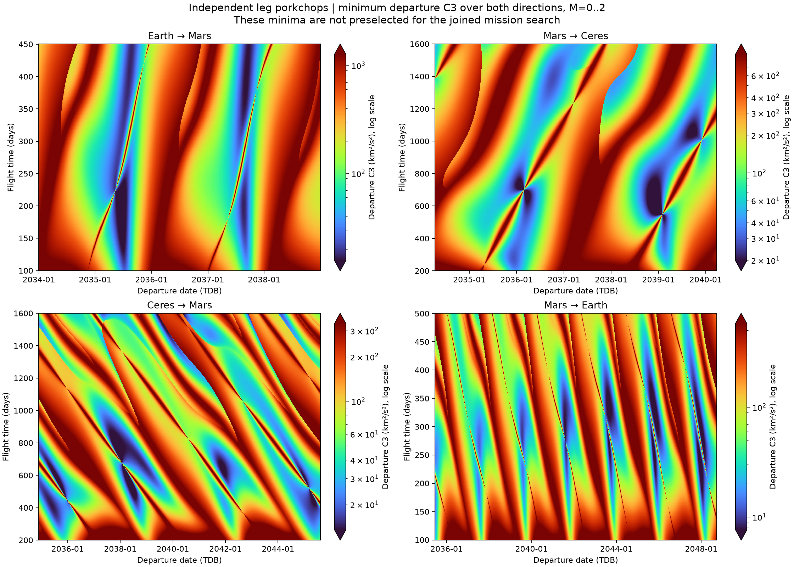
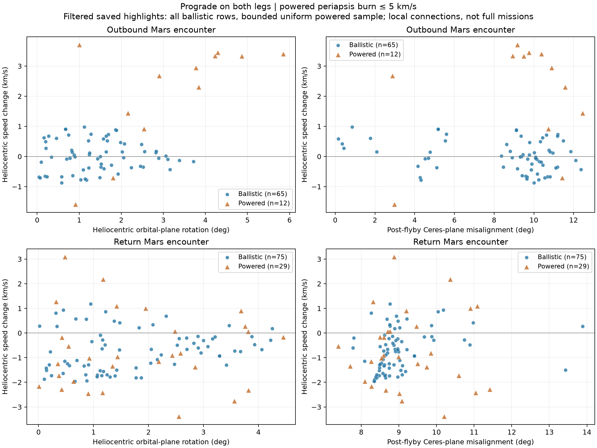

# Overnight EMC survey — October 27, 2026

The daily-grid survey finished at 03:25:55 Mountain, before the 5 AM deadline. It sampled 50,000,000 epoch tuples (including two old anchors) and 11,112,861 independent leg-grid cells, both directions and M=0..2 within the ten-year mission limit.

Saved local Mars connections: 4,887,315 powered outbound, 5,112,183 powered return, 73 ballistic outbound and 77 ballistic return. Of these, 148 ballistic connections were newly refined; both legs of every refined connection passed independent Gooding velocity comparisons and hyperbolic-asymptote recovery. Complete-chain feasibility occurred at 349,602 powered tuples and one ballistic tuple. Local connections are not complete missions.

The best complete cases remain exactly the old anchors: powered 26.999336 km/s and ballistic 52.739012 km/s. They passed 173 and 177 independent patched-conic checks, respectively. No new N-body correction was performed. Neither an optimum nor impossibility follows from the finite sampling and root brackets.

Observed ballistic plane rotations reached 3.72° outbound and 4.25° on return; maximum heliocentric speed gains were 0.984 and 1.178 km/s (not necessarily the same encounters). Powered gains include the charged burn; the unbounded original search includes very expensive and retrograde connections.

## Figures and evidence

The focus requires positive heliocentric angular-momentum z on both legs and powered burns ≤5 km/s. Ballistic highlights contain every accepted ballistic connection; powered highlights are a bounded uniform sample, so filtered counts are not population counts. All-trajectory coverage figures rasterize every accepted sampled connection using uniform true-anomaly points, not time weighting.

Compact JSON evidence and the remaining figures are in [validation/results/emc-overnight](../validation/results/emc-overnight), including source/kernel/library fingerprints, independent complete-chain checks, local-root checks and artifact hashes. Approximately 66.5 GB of compressed chunks remain in the local overnight job; they are not committed.

## Measured throughput

On the Intel Core Ultra 7 265H / NVIDIA RTX PRO 2000 Blackwell Laptop, the mixed 79,200-row workload achieved 0.192 million Lambert branch attempts/s on one CPU thread, 2.685 million/s on 16 threads and 4.894 million/s with resident CUDA. Flyby CUDA reached 84.501 million branch-pair attempts/s. Failed/infeasible attempts count; resident CUDA excludes allocation and transfers, while CPU uses wall time.

The survey executed 2.111 billion grid/survey Lambert branch attempts and 20 billion flyby branch-pair attempts, excluding extra benchmark/refinement/validation work. Mean GPU utilization across the whole run was 7.1%, indicating host work dominated. The concurrent stress phase reached approximately 16 CPU cores and 100% GPU utilization, with a recorded GPU peak of 73 °C. Kernel rates should not be interpreted as complete mission-search rates.

To regenerate the added focus and independent local-root checks from the saved run, use the scientific virtual environment to run `tools/plot_emc_sweep_focus.py RUN_DIRECTORY --check-ballistic-roots`.
