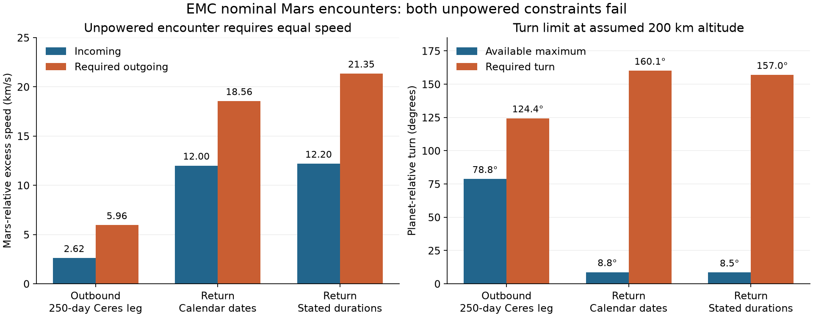
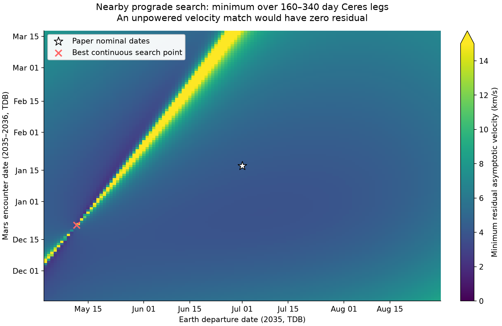

# EMC trajectory audit: reconstructed published example

Audit date: October 19, 2026 (America/Denver). Reviewed source: the supplied 15-page
EMC manuscript, particularly sections X–XII on pages 11–12. Source SHA-256:
`a6906644767ad5851cf880b9c1aaba1f12f1f598cd992069e819f185ef796858`. The original PDF is preserved in the local audit deliverables.

## Finding

**The published example does not close as a sequence of unpowered Mars gravity
assists under the reconstructed dates.** Both Mars encounters fail the
planet-relative speed and turn constraints, for both reasonable interpretations
of the inconsistent calendar. This is a material problem with the specific
itinerary and its use as evidence for the paper's propellant conclusion.

The calculation does not establish that every Earth–Mars–Ceres architecture is
infeasible. It does not compare a fully optimized EMC mission with an equivalent
Mars-only baseline. A correction should distinguish the invalid reconstructed
example from the wider architecture question.

## Reconstruction and date ambiguities

Every date is assumed to mean 00:00 TDB because the source does not supply exact
epochs or a time scale. The literal Ceres arrival year 2026 is incompatible with
the 2035 launch; the calendar interpretation assumes the intended year is 2036.
One month is taken as 30 days in the duration interpretation; the calendar
interpretation uses September 24 to October 24.

| Event | Durations first | Calendar first |
|---|---|---|
| Earth departure | 2035-07-01 | 2035-07-01 |
| First Mars encounter | 2036-01-17 | 2036-01-17 |
| Ceres arrival | 2036-09-23 (250 days) | 2036-09-24 (251 days) |
| Ceres departure | 2036-10-23 | 2036-10-24 |
| Return Mars encounter | 2038-01-16 (450 days) | 2037-12-18 (420 days) |
| Earth return | 2038-05-21 (125 days) | 2038-04-22 (125 days) |

Thus correcting the Ceres year alone does not reconcile the itinerary. The
stated 450-day return leg differs by 30 days from the corrected calendar dates.
These editorial discrepancies are independent of the dynamical failures below.

## First Mars encounter: the plane change is coupled to energy and direction

The reconstructed incoming and outgoing heliocentric transfer planes differ by
**10.821°**. The recollection of an approximately 11° spacecraft plane
change is therefore consistent with these particular legs. The earlier 9.05°
planet-orbit mutual inclination is a different quantity.

The full Mars-relative vectors for the 250-day Ceres leg, in ECLIPJ2000 km/s, are:

- Incoming: (2.305290, -0.691192, -1.033401).
- Required outgoing: (-0.716135, 4.319514, 4.037834).

Their magnitudes are 2.619165 and 5.956103 km/s. A ballistic flyby preserves
planet-relative excess speed. The outgoing leg demands **3.336938 km/s more excess
speed**. Its excess-energy C3 is approximately 35.475 km²/s², compared with about
6.860 km²/s² on approach. These are Mars-relative values, separate from the
Earth-departure C3 of approximately 10.540 km²/s².

The angle between these vectors is 124.381°, whereas a spherical Mars radius of
3396.2 km and an assumed 200 km minimum altitude permit at most
78.767° at the incoming speed. Even a surface-grazing two-body hyperbola permits
only 80.733°. Reducing the assumed atmospheric safety altitude cannot fix this
case. If one ignores the speed mismatch and solves for the incoming-speed turn
alone, the inferred periapsis centre distance is only about 815 km, deep inside
Mars. This counterfactual radius is a turn diagnostic, not a valid encounter.

Using September 24 instead of September 23 changes the required outgoing speed
to 5.948567 km/s and the turn to 124.292°. The verdict is unchanged.

## Return Mars encounter

| Prograde reconstruction | Incoming excess speed | Required outgoing excess speed | Required turn | Available turn at 200 km |
|---|---:|---:|---:|---:|
| First Mars encounter, 250-day Ceres leg | 2.619 km/s | 5.956 km/s | 124.38° | 78.77° |
| Return encounter, calendar dates | 12.000 km/s | 18.560 km/s | 160.14° | 8.76° |
| Return encounter, stated durations | 12.199 km/s | 21.353 km/s | 156.99° | 8.50° |



Both geometric orientations were tested for every nominal leg. Neither
orientation pairing yields a ballistic encounter at either Mars passage. M=1
and M=2 have no solutions for these boundary conditions. For M=1 the nominal
minimum flight times are roughly 721–1245 days, well above the respective leg
durations. At fixed geometry the multi-revolution time increases pointwise with
M, so still higher revolution counts cannot restore these nominal legs.

The restricted powered model implemented in the new solver (a tangential
impulse at a common periapsis) also rejects the nominal encounters at 200 km.
This does not exclude a more general powered flyby or a mission redesigned with
deep-space maneuvers. No claim of minimum fuel for such redesigns is made here.

## Nearby date and branch search

The search used Earth departures from May 2 through August 30, 2035; Mars
encounters from November 18, 2035 through March 17, 2036; and Mars–Ceres flight
times from 160 through 340 days. Launch and encounter dates and initial TOFs were
sampled daily. Both geometric orientations and M=0,1,2 branches were retained
until after velocity matching; no per-leg minimum-C3 reduction was used.

- 365,420 attempted Lambert branch rows: 73,084 successful M=0 rows, with all
  attempted M=1/2 rows explicitly classified as no solution.
- 10,600,084 successful incoming/outgoing candidate pair evaluations.
- 439 daily-TOF sign crossings refined continuously using actual SPICE states.
- No root-refinement failures and no successful ballistic encounters.
- All 439 speed-equality cases still require periapsis inside Mars. The largest
  inferred radius is only 799.533 km from its centre.
- Even allowing a surface-grazing encounter, the best speed-matched case is
  short of turning capability by 42.379°. At 200 km it is short by
  43.605°.

Repeated differential-evolution searches also varied all three dates
continuously inside this same box, with three seeds per orientation combination.
All three prograde/prograde runs converged to essentially the same positive
mismatch near **2.222680 km/s**. The other nine orientation runs reached their iteration
caps and are retained as finite search results, not convergence certificates.

The mismatch metric is the smallest outgoing velocity-vector discrepancy after
an optimistically oriented unpowered flyby, with periapsis at or above the
minimum radius and no finite upper-radius restriction. It is a useful zero-test
for ballistic compatibility. Its nonzero value is **not** a minimum general
powered-flyby burn or a complete mission delta-v budget.



The daily grid can miss tangential roots, disconnected feasible islands, and
solutions between launch/encounter dates. The continuous searches are stochastic.
Neither calculation proves global infeasibility. Outgoing TOFs beyond 340 days,
other launch windows, and a broad search of the return itinerary remain outside
this neighborhood check.

## Ceres visit and the propellant conclusion

For the prograde duration-based reconstruction, arrival excess speed at Ceres
is about 6.791 km/s and departure excess speed about 7.224 km/s. For the calendar
reconstruction they are about 6.746 and 7.781 km/s. These are not rendezvous
conditions. Capture, landing, departure, and any separate crew vehicles require
explicit treatment before a claim about incremental mission propellant can be
assessed.

As an illustrative energy estimate only, assume a spherical 482.1 km Ceres
radius and impulsive capture/escape at that radius. Capture to just-bound energy
plus escape from just-bound energy costs approximately 13.033 km/s for the
duration reconstruction, or 13.543 km/s for the calendar reconstruction. The
estimate deliberately omits finite-period parking-orbit and surface-visit costs;
it is not an optimized mission budget or a comparison against the Mars-only
baseline. Different hardware and mission assumptions need their own budgets.

## Independent verification

All calculations used geometric Sun-centred ECLIPJ2000 states, TDB time and SI
units. Mars body centre 499 was supplied by mar099s, rather than substituted with
Mars-system barycenter 4. Kernel hashes and exact input states are preserved.

The custom CUDA engine's 16 successful nominal leg solutions were independently
checked with Gooding's different Lambert algorithm. The largest endpoint
velocity difference was **4.89e-11 m/s**. Independent central-force DOP853
propagation of every nominal feasible arc closed position within **0.752 m**.
This verifies the heliocentric two-body boundary solutions; it does not assert
full N-body mission accuracy.

Additional checks covered 256 sampled search-population solutions and all 439
speed-equality roots using Gooding. Maximum sampled endpoint velocity difference
was 1.992e-10 m/s; independent speed-root mismatch stayed below
3.421e-09 m/s. All 439 roots failed the turn test even at the reference surface.

Fresh public Horizons queries were separately solved with Gooding. The largest
state-position differences relative to the pinned kernels were approximately
0.0423 m for Earth, 0.0000611 m for Mars and 0.674 m for Ceres. The largest
state-velocity difference was below 1.2e-7 m/s. The same encounter failures were
reproduced. Full request parameters, response headers, hashes and timestamps are
preserved. The kilometre-per-second mismatch is much larger than the measured
numerical and ephemeris differences.

## Interpretation and recommended next action

The nominal published case should not be presented as a validated, unpowered
EMC itinerary on this evidence. Review the original saved candidate dates,
state vectors, branch selections, periapsis and propulsion assumptions with the
coauthors. Unless those records establish a different, fully closed trajectory,
a technical correction or clarification of the example and its supporting
propellant conclusion is warranted.

The reported cranking-then-pumping procedure does not by itself demonstrate a
full-vector encounter match. Target inclination and a C3 value do not specify
all the required velocity components. The original program may contain checks
not described in the paper; its precise failure mechanism has not been proved
from the manuscript alone. This audit does not attribute every discrepancy to
the legacy helper-code defects found during the solver upgrade.

A future revised analysis should solve shared encounter epochs and full 3D
velocities jointly, retain Lambert branches through flyby matching, include the
Ceres visit and return costs, and compare a feasible EMC design with a consistent
Mars-only baseline. The aerobraking/crew-load analysis and other non-trajectory
claims were not audited here.

## Reproduction and preserved evidence

The runtime numerical solver was unchanged by this audit. Validation scripts
require the existing validation dependencies plus the research SPICE/plot stack.
The extra Mars kernel is pinned by URL, byte count and SHA-256 in
`validation/data/emc-audit/kernel-sources.json`. No kernel download runs implicitly.
The original source PDF is required for its input fingerprint.

```bash
python validation/audit_emc.py --paper /path/to/source.pdf \
  --outdir /path/to/audit/run --backend cuda --search
python validation/audit_emc_horizons.py /path/to/audit/run --refresh
python validation/audit_emc_continuous.py /path/to/audit/run
python validation/check_emc_audit.py /path/to/audit/run
python validation/plot_emc_audit.py /path/to/audit/run --outdir /path/to/audit/figures
```

Omit `--refresh` for an offline Horizons comparison when its snapshots are
already present. CPU-only nominal/search work uses `--backend cpu`; continuous
refinement and independent validation intentionally use the CPU. The large
branch-population NPZ is preserved in the local audit bundle rather than Git.

- [Exact nominal states and all branch diagnostics](../validation/results/emc-audit/nominal.json).
- [Nearby search domain, failures and best candidates](../validation/results/emc-audit/neighborhood.json).
- [All speed-equality roots](../validation/results/emc-audit/speed-equality-roots.csv).
- [Continuous-search results, seeds and termination statuses](../validation/results/emc-audit/continuous-search.json).
- [Independent checks and altitude sensitivity](../validation/results/emc-audit/independent-checks.json).
- [Horizons comparison](../validation/results/emc-audit/horizons-crosscheck.json).
- [Environment, input and artifact fingerprints](../validation/results/emc-audit/provenance.json).

Primary technical references: [ESA encounter constraints](https://esa.github.io/pykep/flyby.html),
[JPL Horizons API](https://ssd-api.jpl.nasa.gov/doc/horizons.html), and
[NAIF satellite kernels](https://naif.jpl.nasa.gov/pub/naif/generic_kernels/spk/satellites/).
